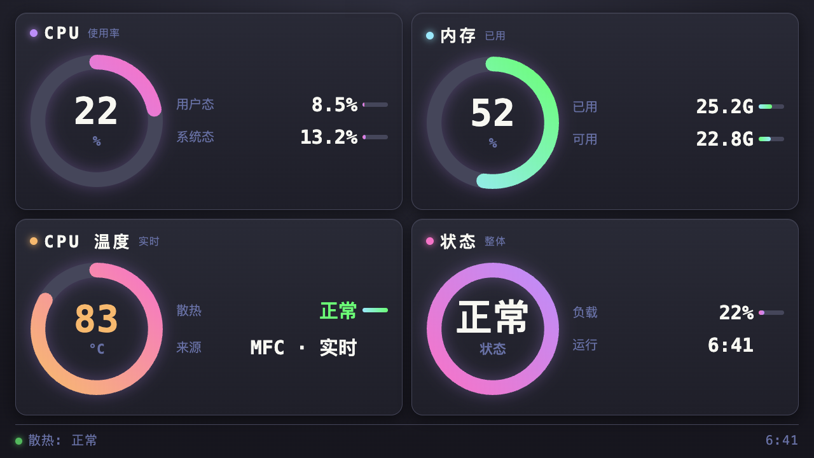

# Mac mini 小屏监控仪表盘

在 **wokyis M5 雷电5 扩展坞的小屏（1280×720）** 上显示 Mac mini 实时状态的翻页时钟风格仪表盘：**CPU / 内存 / CPU 温度 / 状态** 四张大卡，Dracula 多色渐变 + 圆头环形进度 + 平滑数字过渡。

- 访问地址：`http://127.0.0.1:8080`（本机）
- 数据接口：`http://127.0.0.1:8080/api`（1 秒更新一次 JSON）

---

## 预览



## 重启电脑后怎么启动

只需要两步：

```bash
cd /Volumes/Ti600/dotfile/mac-mini-monitor
./start.sh
```

脚本会自动：杀掉旧服务 → 用系统 Python 启动 `server.py` → 用浏览器打开仪表盘。把小屏浏览器切到全屏即可。

> 注意：**Ti600 必须已挂载**（开机后桌面能看见 Ti600 图标）。如果没挂载，插好雷电线等几秒即可。

---

## 前置条件（温度显示必需）

CPU 温度来自 **Macs Fan Control (MFC)**，这是 macOS 26 上唯一能读出 M5 Pro 温度的通道。需要满足：

1. **MFC 已安装**：`brew install --cask macs-fan-control`
2. **辅助功能已授权**：系统设置 → 隐私与安全性 → 辅助功能 → 勾选 Macs Fan Control（已授权过，重装系统后需重新勾）
3. **MFC 在菜单栏常驻即可**：温度从菜单栏常驻项直接读取（如 `75°C`），**主窗口可以关闭**（关闭不影响读数）

不满足时，温度卡会显示 `--` 和「请打开 MFC」。

---

## 手动操作（可选）

```bash
# 启动
cd /Volumes/Ti600/dotfile/mac-mini-monitor
nohup /usr/bin/python3 server.py > /tmp/mac-mini-monitor.log 2>&1 &

# 停止
lsof -ti :8080 | xargs kill -9

# 看日志
tail -f /tmp/mac-mini-monitor.log

# 检查服务是否在跑
curl -s http://127.0.0.1:8080/api
```

---

## 页面内容

| 卡片 | 环形（渐变） | 参数行 |
| --- | --- | --- |
| CPU | 紫→粉，总使用率 | 用户态 / 系统态 |
| 内存 | 青→绿，已用占比 | 已用 / 可用 |
| CPU 温度 | 低温青绿；≥70° 橙粉；≥85° 红 | 散热状态 / 数据来源 |
| 状态 | 粉→紫 | 负载 / 运行时长 |

底部状态条显示散热压力（正常 / 偏高·限频）。

---

## 常见问题

**Q：温度卡显示 `--` 或「请打开 MFC」？**
A：确认 MFC 在运行、菜单栏能看到温度项（如 `75°C`）；并确认「辅助功能」里已勾选 MFC。主窗口关不关都不影响。

**Q：8080 端口被占用起不来？**
A：`lsof -ti :8080 | xargs kill -9` 清掉旧进程再 `./start.sh`。

**Q：页面没变化 / 颜色不对？**
A：浏览器强刷 `Cmd+Shift+R`（服务端已加 `Cache-Control: no-store`，正常不会缓存）。

**Q：小屏显示不全或太大？**
A：小屏全屏后页面自适应 1280×720；字号、卡片数量都可在 `index.html` 里调整。

**Q：找不到 /Volumes/Ti600？**
A：Ti600 没挂载，检查雷电/USB4 连接线与扩展坞供电。

---

## 目录与 Git

```text
/Volumes/Ti600/dotfile/mac-mini-monitor/
├── server.py    # 数据服务（CPU/内存/温度/散热，HTTP :8080）
├── index.html   # 前端仪表盘（四卡、SVG 圆头环形、Dracula 渐变）
├── start.sh     # 一键启动脚本
└── README.md    # 本说明
```

Git 说明：工作树在 Ti600，**git 元数据在系统盘** `/Users/persilee/Doubao/git/mac-mini-monitor.git`（Ti600 内 `.git` 只是指针文件，因为 Ti600 上删除文件会报 `EXDEV`，git 锁删不掉）。日常 `git add/commit/status` 照常使用即可。

提交习惯：每次改动后 `git add -A && git commit -m "说明"`。
